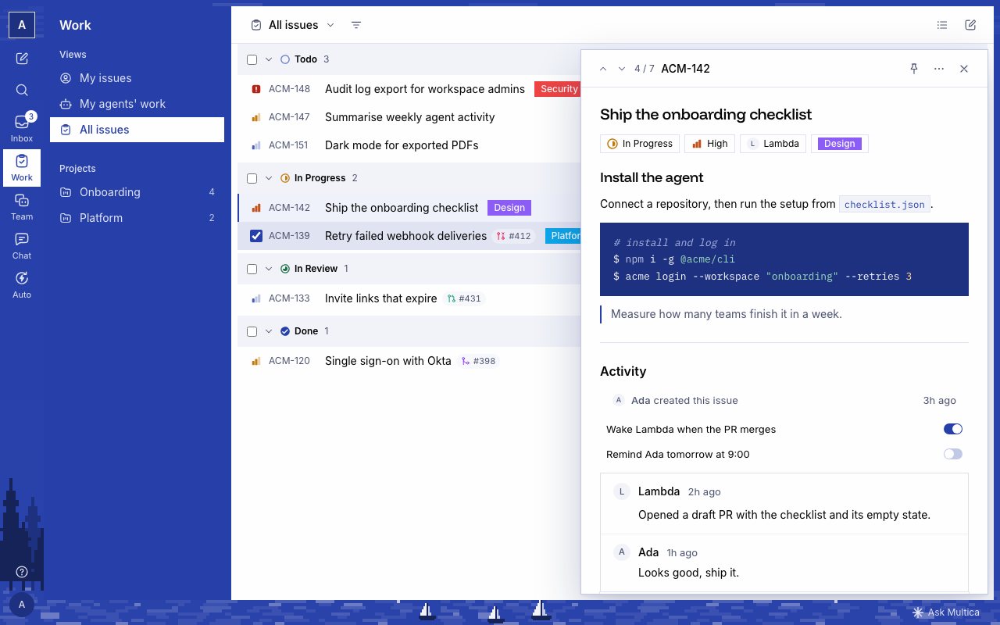
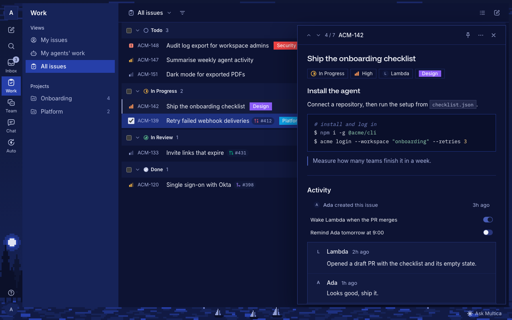
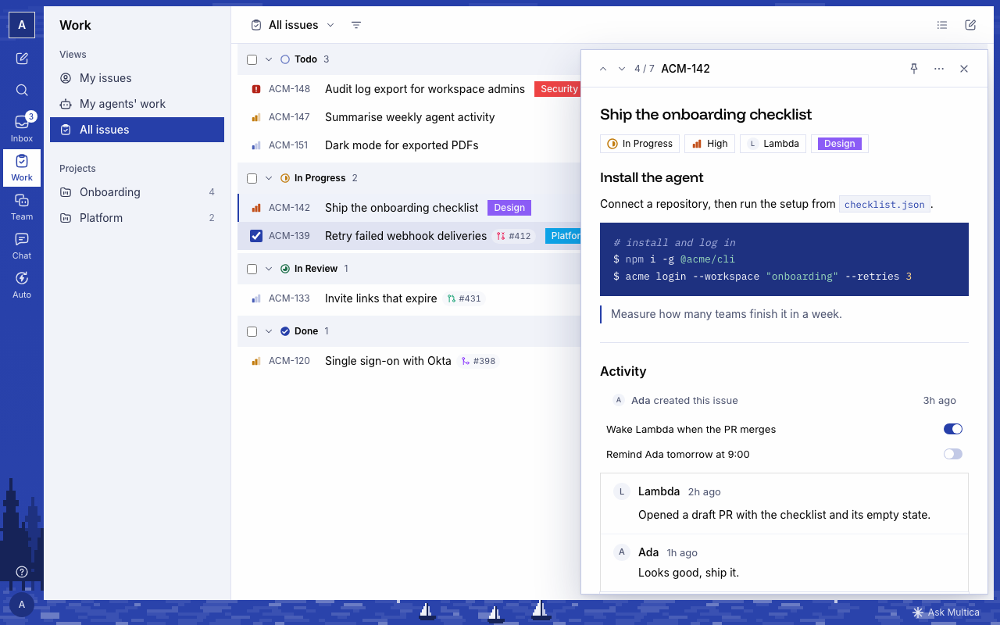

# Fathom

A deep-ocean blue theme for [Multica](https://multica.ai): an ocean frame with a pixel-art sea (spruce on the shore, sails along the bottom bar, streaks of cloud overhead), white pages, navy terminal code blocks, and a night sea with a glowing moon in dark mode.

| Light | Dark |
| --- | --- |
|  |  |

## Install

In Multica, open **Settings → Appearance → Manage** and install Fathom from the theme store. Or download `theme.zip` from the [latest release](../../releases/latest) and import it under **Settings → Appearance → Import theme**.

## Options

Under **Settings → Appearance → Theme options**:

- **Pixel sea in the frame**: on by default; off leaves a plain ocean frame.
- **Sidebar**: Ocean (default) or Mist, a pale blue-grey panel.
- **Square corners**: on by default; off gives small rounded corners.
- **Display headings**: issue titles and headings in Funnel Display.
- **Code blocks**: Terminal (navy) or Paper (pale blue), light mode only.



## Develop

Check the theme from a checkout of [multica-ai/multica](https://github.com/multica-ai/multica):

```sh
pnpm theme:check path/to/this/folder
```

To release, bump `version` in `manifest.json`, then tag the commit with the same version (`v2.0.1`) and push the tag. The release workflow attaches `theme.zip`.

## License

The theme (CSS, manifest and images) is MIT. The bundled fonts keep their own license, the SIL Open Font License 1.1: [Funnel Display](fonts/OFL-FunnelDisplay.txt) and [IBM Plex Mono](fonts/OFL-IBMPlexMono.txt).
